# CS4243 Lab 2 report

This compact report records how every `YOUR CODE HERE` section is exercised. Elaborate on your implementation and the results you observed; add figures, plots and grounded reasoning that show your understanding. Every reported number names its clip (common / viewpoint / scale / blur / exit / combined / your clip), frame subset (validation / test / audit) and method variant, and comes from `overlaylab.metrics` or `overlaylab.evaluate`. Thresholds are frozen on the common clip's validation frames; each Stage's **stress table** (`python -m overlaylab.report`, `outputs/stress_tables.md`) reports the common clip (validation and test) and the Stage's two stress clips with that frozen configuration.

> All Stage 1 and Stage 2 numbers in this report were produced by one set of runs (OpenCV 4.10) and match `outputs/stress_tables.md` exactly. Re-running the same code under OpenCV 4.14 reproduces every qualitative conclusion and every stress-table value; only sub-pixel / ±1-count details of the labelled `cv2` comparison cells differ. A single run is quoted throughout so that every figure is traceable to the same notebook execution.

## Stage 1 — Localise
<!-- harris_response, detect_corners, describe_keypoints, match_descriptors; bilinear_sample, normalise_points, dlt_homography, symmetric_transfer_error, ransac_homography, transfer_points, warp_artwork; localise_board, artwork_to_frame, overlay_frame, evaluate_audit_frames; frozen success threshold -->

Stage 1 localises the planar board in each frame from the rectified reference image alone, then uses the recovered homography to place the artwork. The pipeline runs in three branches.

**Keypoints (`keypoints.py`).** `harris_response` builds the Gaussian-weighted second-moment matrix `M` from the supplied normalised Sobel gradients and returns `R = det(M) − κ·tr(M)²`; the response peaks at corners and is non-positive on edges and flat regions (Notebook 1, §3, Fig. "signed-log Harris response"). `detect_corners` thresholds `R` at `response_fraction·max(R)`, removes a border band, and applies one of two non-maximum-suppression modes. The NMS mode decides *where* corners land: the count sweep (Notebook 1, §3) shows "window" NMS at `sigma_w=2.0` keeps 214 corners (121 board / 93 background) while "radius" NMS keeps far more, better spatially distributed, board corners. The repeatability sweep over mode × `sigma_w` × κ (Notebook 1, §3 EXPLORATION, repeatability = fraction of frame-A corners whose GT transfer lands within 3 px of a frame-B corner) selects **radius NMS, `sigma_w=2.0`, `κ=0.05`, repeatability 0.852 over 364 board points** — radius NMS is kept because it yields many more distributed board points while keeping repeatability within a hair of the best window setting (0.84). `describe_keypoints` produces 128-D gradient-histogram descriptors (4×4×8) with dominant-orientation normalisation, trilinear accumulation, Gaussian spatial weighting, L2-normalisation and clamping. `match_descriptors` applies Lowe's ratio test (optionally mutual): on a representative reference→frame pair it matches 349 reference against 600 frame descriptors, 200 survive the ratio test at 0.8, and of the 223 correct nearest neighbours 194 are correctly accepted, 29 correctly rejected, and only 6 wrong neighbours slip through (Notebook 1, §4). The ratio-test histogram (Notebook 1, §4, Fig.) shows repeated poster letters producing near-equal first/second distances that the ratio test correctly suppresses.

**Geometry (`geometry.py`).** `bilinear_sample` (reused from Lab 1, extended to colour) is the sampling primitive inside the warp and the flow. `normalise_points` applies Hartley normalisation (zero centroid, mean distance √2) so that `dlt_homography` solves a well-conditioned `A h = 0` system via SVD, returning the smallest-singular-vector solution denormalised to `H[2,2]=1` together with the singular values and a status flag. The conditioning benefit is explicit (Notebook 1, §6): normalised DLT gives corner error 0.0472 % at condition number `σ₁/σ₈ = 3.36`, while un-normalised DLT on the same points gives a comparable error here but condition number `2.01e+05`, and that gap explodes with coordinate magnitude (condition number reaches `2.84e+10` at a +8000 px offset while the normalised path stays at 4.2). `dlt_homography` returns `status=False` on degenerate input: a collinear configuration and a 3-collinear+1 configuration both fail, with the two smallest singular values `[0.9696, 1.73e-16]` revealing a 2-dimensional null space (the generic smallest-singular-value ratio is `1.79e-01` versus `2.85e-17` in the degenerate case). `symmetric_transfer_error` scores each correspondence by `|x′−π(Hx)|² + |x−π(H⁻¹x′)|²`, the residual that `ransac_homography` thresholds; RANSAC draws minimal four-point samples with an adaptive `N(p,ε)` iteration bound and refits on the consensus set. Its behaviour is characterised in Notebook 1, §7: with injected outliers, a 2 px threshold and a 200-iteration cap recovers 56 inliers at 0.079 % corner error, and the adaptive iteration count tracks the theoretical `N(0.995, ε)` closely (e.g. `ε=0.5` → `N=83`, used 83). `transfer_points` projects points through `H`; `warp_artwork` does the destination-to-source bilinear warp with a Boolean coverage mask, verified against a known-`H` checkerboard (coverage bbox x:[60,300] y:[40,150], matching the expected quad; Notebook 1, §8).

**Localisation (`localisation.py`).** `localise_board` ties the branches together: detect/describe/match reference↔frame, estimate the homography with RANSAC, reject implausible (non-convex or reflected) quads, and project the four reference corners. `artwork_to_frame` composes the artwork rectangle with the board rectangle and `H`; `overlay_frame` paints the warped artwork inside its coverage (single-frame overlay, Notebook 2, §6). `evaluate_audit_frames` runs `localise_board` over the annotated frames and summarises with `metrics.summarise_errors`. On the common clip it is excellent: all 13 resized **validation** frames returned a model, and 12 met the 1% threshold. Frame 448 exceeded it at 1.96%. The **test** summary is `{n:13, median:0.47 %, p90:0.67 %, success:1.0, failed:0}` (Notebook 2, §2–§3). The success threshold is frozen at **1.0 %** of the longer annotated board diagonal — the validation 90th-quantile corner error (0.79 %) rounded up — and recorded in `outputs/thresholds.json`.

### Stress table (Stage 1)
<!-- generated rows: common · validation, common · test, viewpoint, scale — median / p90 corner error, success at the frozen threshold, inliers, inlier ratio, affine median error / success -->

| row                          | frames | median err | p90 err | success | inliers (median) | inlier ratio | affine median err | affine success |
| ---------------------------- | ------ | ---------- | ------- | ------- | ---------------- | ------------ | ----------------- | -------------- |
| common · validation          | 13     | 0.43%      | 0.56%   | 85%     | 96               | 0.842        | 0.71%             | 54%            |
| common · test                | 13     | 0.36%      | 0.52%   | 92%     | 98               | 0.886        | 0.87%             | 62%            |
| viewpoint (coke_perspective) | 32     | 0.43%      | 0.82%   | 59%     | 23               | 0.640        | 3.25%             | 6%             |
| scale (coke_scale)           | 32     | 0.32%      | 0.65%   | 25%     | 4                | 0.500        | 0.65%             | 19%            |

`localise_board` on every annotated frame with the frozen configuration; *affine* = 6-parameter least-squares fit to the same RANSAC inliers. The row the Stage points at is the **scale** clip: where the localiser succeeds the median corner error is tiny (0.32 %), but success collapses to **25 %** because the descriptor loses correspondences as the board shrinks to 0.29× of its reference size — the median inlier count drops to 4 (the minimum for a homography), so most frames never reach the 1 % threshold. The viewpoint clip keeps 59 % success because a full homography still fits the orbiting board; its affine error (3.25 %) is already much larger than the homography error, foreshadowing Question 2.

### Question 1 — Matching
<!-- a frame pair on the viewpoint or scale clip where the matching rate collapses; rotation absorbed by the dominant orientation vs viewpoint / scale not absorbed; which descriptor component fails; the labelled SIFT cell -->

The matching rate collapses on the **scale clip between frames 80 and 96** (Notebook 1, §5, auto-selected as the largest adjacent-frame drop): the inlier-matching rate falls from **0.573 to 0.212**. Over that pair the in-plane rotation barely moves (1.5° → −0.4°, a −1.9° delta) and the keystone is essentially flat (1.015 → 1.003), while the board scale changes by ×0.91 — so this is a near-pure **scale** collapse. The viewpoint clip's largest adjacent drop (frames 448 → 464, 0.324 → 0.077) adds out-of-plane tilt on top.

The isolated controls make the mechanism explicit: the descriptor **retains 96 % of matches after a 30° in-plane rotation but only 10 % after a 0.6× downscale**. The reason is architectural. The descriptor estimates a *dominant orientation* and rotates its sampling grid to it, so an in-plane rotation is cancelled before the histogram is built — rotation is **absorbed**. But the support region is a **fixed-size** 16-sample grid at a fixed pixel spacing; nothing rescales it with the board and nothing shears it. A scale change therefore makes the reference and frame descriptors integrate over physically different neighbourhoods, and the viewpoint orbit adds a projective keystone shear the similarity-invariant grid cannot match. The failing component is thus the **fixed spatial support / sampling scale**, not the orientation normalisation.

The labelled SIFT ablation (Notebook 1, §5, the only cell where `cv2.SIFT` is permitted) confirms this is a scale-invariance gap and not a bug: on the worst subset frame (448) our descriptor scores a 0.155 matching rate against SIFT's 0.172. SIFT survives the same scale/viewpoint change slightly better precisely because it detects features across a scale-space pyramid and sizes each descriptor to the detected scale — the invariance our single-scale support lacks.

### Question 2 — Geometry
<!-- the affine column on the viewpoint clip: why the affine fit breaks as the camera orbits, related to the keystone; whole-frame warp and parallax; why parallax does not harm the overlay and one capture condition under which it would -->

The affine column on the **viewpoint clip** is the evidence (Notebook 2, §5, affine fitted by least squares to the *same* RANSAC inliers as the homography). Across the clip the median corner error is **0.50 % for the homography but 3.41 % for the affine fit**, and success at the 1 % threshold is **72 % vs 9 %**. The per-frame table shows the affine error growing monotonically as the camera orbits away from fronto-parallel — e.g. 0.87 % → 3.59 % → 6.88 % → 9.53 % as the keystone ratio increases, then shrinking again as the board returns to front. The cause is geometric: an affine map keeps opposite sides parallel, so it **cannot represent the edge convergence (keystone) produced by the out-of-plane rotation**. A homography has exactly the two extra projective degrees of freedom needed for that convergence. The correlation is almost perfect: Pearson *r* between the measured keystone ratio and the affine error is **0.998** (keystone range 1.030–1.566), and the worst successfully-localised frame (240, keystone 1.535) has an affine error of 10.72 %. This also explains why the Stage 1 stress table reports affine success of only 6 % on the viewpoint clip against 59 % for the full localiser.

The **parallax** question is addressed by the whole-frame warp cell (Notebook 2, §6, the labelled `cv2.warpPerspective` comparison). Warping an entire frame by the board-fitted homography between two viewpoint frames with real camera translation (frames 224 → 496): the board plane aligns tightly (median `|difference|` inside the board **0.059**) while the background does not (valid-background median `|difference|` **0.072**). The homography is exact only for the board's plane; background points lie at different depths and so move by different amounts under camera translation — classic parallax. This **does not harm the overlay** because the artwork is painted only inside the board's coverage mask, where the single-plane homography is valid; the mis-registered background is never touched. The one capture condition under which parallax *would* harm the result is when something the overlay must respect does **not** lie in the board plane — for example an occluder standing in front of the board at a different depth, or texture on a non-coplanar frame/bezel around the poster: there the board homography mislocates those out-of-plane pixels, which is exactly why Stage 3 needs a separate occlusion signal rather than relying on the homography alone.

## Stage 2 — Track
<!-- lk_flow, track_board (both variants on the common clip), failure_monitor; jitter and drift; frozen monitor thresholds -->

Stage 2 turns per-frame localisation into a temporal track and adds a failure monitor.

**`lk_flow`** is an iterative single-level Lucas–Kanade solver at sparse points: for each point it builds the structure tensor from the supplied Sobel gradients of the previous frame, normalises it by the window size so `min_eigenvalue` is scale-free, and iterates the warp with bilinear sampling until convergence. A point is invalidated when `λ₂` is too small, the brightness residual is too large, the iteration diverges, or the window leaves the image. On the consecutive segment around the occlusion (Notebook 2, §7) it tracks 82 points but keeps only **5 valid** (median `|flow|` 26.94 px); the eigenvalue scatter separates the two failure modes cleanly — points on the straight board edges have a small `λ₂` (the **aperture problem**: flow is observable only across the edge), while points under the moving occluder have large brightness residuals (**brightness-constancy violation**). The labelled `cv2.calcOpticalFlowPyrLK` comparison agrees to **0.023 px** median over the points both consider valid (Notebook 2, §7).

**`track_board`** runs two variants on the common clip (Notebook 2, §8). The *independent* variant re-localises from the reference every frame; the *flow-assisted* variant localises once, then propagates the inlier correspondences with `lk_flow` and re-estimates the homography, reinitialising only when too few points survive, on a schedule, or when RANSAC fails. On a 70-frame segment the independent variant is `ok` on 66/70 frames with **66 reinitialisations** and jitter 2.06 px, whereas flow-assisted is `ok` on 69/70 with only **8 reinitialisations** and jitter 2.24 px. Because it reinitialises every frame, the independent variant carries no track (max 0 frames since reinit, so drift is **n/a**); the flow-assisted variant carries a track up to 20 frames with a median corner error of **0.63 % at ≥16 frames after reinit** — i.e. it trades per-frame flicker for slow drift.

**`failure_monitor`** maps the per-frame statistics to OK / REINIT / HIDE. Because a homography is defined only up to scale, it compares *projected-corner displacement and reprojection error*, never homography matrices. The required policy is: no model → HIDE; low inlier count/ratio → REINIT, escalating to HIDE after a run of consecutive bad frames; otherwise the first of median residual, corner displacement, mean flow, brightness change to exceed its frozen maximum → REINIT; else OK. On the synthetic illumination-step stress sequence the **first non-OK flag is `(45, REINIT, 'brightness_change')`** (Notebook 2, §9) — the brightness term fires exactly when the lighting jumps, which is what distinguishes an appearance change from a geometric one. The monitor thresholds are frozen in `outputs/thresholds.json` and left unchanged for all test/stress reporting.

### Stress table (Stage 2)
<!-- generated rows: common · validation / test for both variants, blur, exit — corner metrics, jitter, drift, frames tracked, REINIT / HIDE counts -->

| row                                     | frames | median err | p90 err | success | jitter  | drift (≥16 fr) | longest run | tracked | (re)localisations | REINIT flags | HIDE flags |
| --------------------------------------- | ------ | ---------- | ------- | ------- | ------- | -------------- | ----------- | ------- | ----------------- | ------------ | ---------- |
| common · validation · independent       | 13     | 0.43%      | 0.56%   | 85%     | 6.32 px | n/a            | 16          | 455     | 455               | 114          | 45         |
| common · validation · flow-assisted     | 13     | 0.34%      | 0.56%   | 85%     | 6.33 px | 0.34%          | 21          | 458     | 158               | 114          | 42         |
| common · test · independent             | 13     | 0.36%      | 0.52%   | 92%     | 6.32 px | n/a            | 16          | 455     | 455               | 114          | 45         |
| common · test · flow-assisted           | 13     | 0.37%      | 0.69%   | 85%     | 6.33 px | 1.00%          | 21          | 458     | 158               | 114          | 42         |
| blur (coke_blur) · flow-assisted        | 32     | 0.54%      | 0.62%   | 9%      | 3.69 px | n/a            | 145         | 38      | 20                | 15           | 462        |
| exit (coke_out_of_view) · flow-assisted | 30     | 0.75%      | 1.67%   | 43%     | 6.94 px | n/a            | 21          | 364     | 205               | 156          | 136        |

From the `_stats.json` of each run. Jitter uses the full available corner trajectory for motion interpolation and is therefore identical in a variant's validation and test rows; `(re)localisations` counts actual localiser calls, whereas REINIT/HIDE count monitor flags; drift = median corner error on the row's annotated frames at least 16 frames after the last (re)initialisation (n/a when no track is carried that long — the independent variant reinitialises every frame); longest run = most consecutive frames without a (re)initialisation. The two stress rows are the point of the table: on **blur**, brightness constancy and the aperture problem cripple tracking (success 9 %, only 38 frames tracked, **462 HIDE** flags) — the monitor correctly hides the overlay rather than painting a wrong one; on **exit**, the board leaves and re-enters the frame, producing the expected HIDE-then-REINIT cycling (**136 HIDE / 156 REINIT**, 205 relocalisations, success 43 %).

### Question 3 — Tracking
<!-- flicker (independent) vs drift (flow-assisted); eigenvalues: aperture vs brightness constancy, where each kind lies on the board (blur clip); monitor timeline of the combined clip: which statistic fired first at the card crossing and at the fast rotation, occlusion vs drift; what the exit clip's HIDE / REINIT sequence shows -->

**Flicker vs drift.** The independent variant re-solves from the reference every frame, so small localisation errors can appear as frame-to-frame flicker. On the 70-frame common-clip segment in Notebook 2 §8, independent registration recorded **66 reinitialisations** and **2.06 px** jitter, while flow-assisted registration recorded **8 reinitialisations** and **2.24 px** jitter. The full common-clip stress table also shows nearly identical jitter (**6.32 vs 6.33 px**), with fewer localisation calls for flow assistance (**455 vs 158**). Flow did help locally on frames **368–384**, where both variants kept the overlay visible and jitter fell from **7.63 to 7.25 px**. Flow carries correspondences forward, allowing errors to accumulate. At least 16 frames after reinitialisation, the flow-assisted median corner error was **0.34% on validation** and **1.00% on test**.

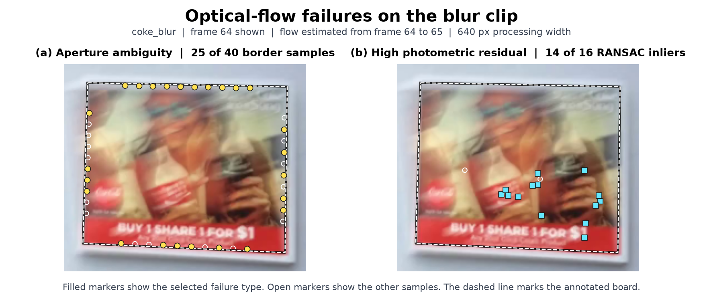

**Eigenvalues: aperture vs brightness constancy (blur clip).** The structure-tensor eigenvalues `(λ₁, λ₂)` from `lk_flow` indicate how well a patch constrains motion. Along straight board edges, a small `λ₂` means that only motion across the edge is well constrained, which is the aperture problem. A large photometric residual after warping indicates a brightness-constancy failure, even when the eigenvalues are adequate. Notebook 2 §7 illustrates these diagnostics on the common clip. In the common-clip example in Notebook 2 §7, only 5 of 82 points passed all Lucas–Kanade validity checks. As the figure above shows, in a separate check on `coke_blur` frames **64–65**, **25 of 40** sampled border points had a sufficiently large `λ₁` but a `λ₂` below the frozen threshold. Of the **16** RANSAC inliers, **14** passed the eigenvalue threshold but exceeded the brightness-residual threshold. All 14 lay inside the board, away from its outer edge. The full-resolution run recorded `HIDE/no_model` on both frames.

**Combined-clip monitor timeline.** Notebook 2 §10 shows the monitor timeline for `coke_unconstrained`. Near the first blue-card crossing, `REINIT/brightness_change` fired at frame **205**, followed by `HIDE/no_model` on frames **206–213**. In the second crossing window (**302–314**), the first non-OK flag was `HIDE/no_model` at **309**. During the fast rotation between annotated frames **80 and 96**, the first non-OK flag was also `HIDE/no_model`, at **83**. A low inlier ratio can indicate either occlusion or drift. Here, the monitor flags the loss of a usable model in both situations. The visible card supports the occlusion interpretation, while a gradual rise in corner error as correspondences are carried forward would be evidence of drift.

**Exit clip HIDE/REINIT sequence.** The exit clip (`coke_out_of_view`) is the clearest case (Stage 2 table: 136 HIDE, 156 REINIT, 205 relocalisations, longest run 21, success 43 %). As the board slides out of frame the localiser loses inliers and the monitor escalates to **HIDE** (nothing is painted while the board is absent — the correct behaviour); when the board re-enters, localisation from the reference succeeds again and the monitor issues **REINIT**, re-seeding the flow track. The "22 scored audit frames, no scored point ≥16 frames after reinit" line (Notebook 2, §10) confirms the clip never holds a long uninterrupted track: it is a repeated lose-and-recover cycle driven entirely by board visibility, not by drift.

## Stage 3 — Composite
<!-- hysteresis, compensated_difference, occlusion_mask, select_difference_thresholds, composite; frozen difference thresholds; no-occlusion baseline -->

Stage 3 uses the estimated homography to align the clean board reference with the video frame, detects which parts of the board are occluded, and blends the warped artwork into the remaining area. The five functions are implemented in `compositing.py`.

**`hysteresis`** starts a queue with all pixels that meet the strong threshold. It then follows neighbouring pixels that meet the weak threshold, keeping only those reachable from a strong seed. The function supports 4- and 8-connectivity, and the frozen configuration uses 8-connectivity. This preserves faint foreground edges connected to a stronger region (Notebook 3, Section 5).

**`compensated_difference`** estimates one gain and offset shared across the RGB channels by least squares. It fits these parameters on the half of the covered board pixels with the smallest raw colour differences, reducing the influence of likely foreground pixels. It then returns the mean absolute RGB residual after compensation, with the residual set to zero outside board coverage (Notebook 3, Section 2).

**`occlusion_mask`** warps the clean reference into the frame using the estimated homography and applies hysteresis to the compensated difference inside board coverage. It opens the mask with a disc of radius **2 processing pixels**, then removes connected components below the minimum area. It returns the Boolean occlusion mask, the difference map, and the bounding box and area of each retained component (Notebook 3, Sections 4 and 6).

**`select_difference_thresholds`** searches the strong threshold, weak threshold, and minimum component area using mean mask IoU on the **three common validation masks**. When configurations tie, it favours the strong threshold nearest the midpoint of the tied range, then the weak threshold and area closest to their starting values. The selected settings were **0.25 strong**, **0.12 weak**, and a **38-pixel** minimum area at 640-pixel processing width. The minimum area was saved as **152 pixels** for full-resolution runs (Notebook 3, Section 3).

**`composite`** paints only where the warped artwork covers the board and the occlusion mask is clear. A distance transform feathers alpha over **3 pixels** inside this region, softening both the board and occluder boundaries. The output is `alpha × artwork + (1 − alpha) × frame`. Alpha is zero outside the paint region, so those pixels retain their source values before encoding. The no-occlusion baseline uses the same blend with an empty occlusion mask (Notebook 3, Section 4).

### Stress table (Stage 3)
<!-- generated rows: common · validation / test, combined, viewpoint — mask IoU / F1 / leakage, baseline leakage (common), false occlusion (viewpoint) -->
| row | eligible masks | scored masks | hidden masks | missing masks | overlay absent | IoU | F1 | leakage | baseline leakage | false occlusion |
|---|---|---|---|---|---|---|---|---|---|---|
| common · validation | 3 | 3 | 0 | 0 | 0 | 0.917 | 0.956 | 1.56% | 96.40% | n/a |
| common · test | 3 | 2 | 1 | 0 | 1 | 0.944 | 0.971 | 0.61% | 61.74% | n/a |
| combined (coke_unconstrained) | 6 | 4 | 2 | 0 | 2 | 0.935 | 0.966 | 0.22% | n/a | n/a |
| viewpoint (coke_perspective) | 3 | 0 | 1 | 0 | 1 | n/a | n/a | n/a | n/a | 10.65% |

IoU / F1 from the occlusion masks saved by `run_pipeline` on the ground-truth mask frames (frames on which the overlay is hidden are not scored); leakage, baseline leakage and false occlusion from `overlaylab.evaluate` on the finished videos. The viewpoint clip has empty masks: only false occlusion applies.

At full resolution, the flow-assisted run with occlusion handling reduced finished-video foreground leakage from **96.40%** to **1.56%** on common validation and from **61.74%** to **0.61%** on common test, compared with the flow-assisted no-occlusion baseline. Both runs hid the overlay on common test frame **448**, which contributed zero leakage to both means. The common test mask IoU covers the two visible frames. The combined clip achieved **0.935** mask IoU on four scored frames, with two hidden. No masks were missing.

**Boundary behavior on the common and combined crossings**

Both examples use independent single-frame localisation at **640-pixel width** with the frozen settings (Notebook 3, Sections 4 and 6).

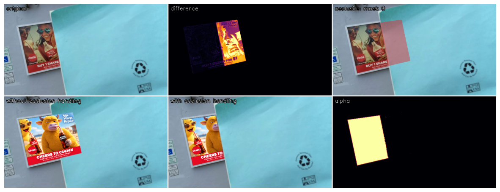

**Common clip, test frame 144.** The difference map highlights the part of the board covered by the blue card. The no-occlusion composite paints across the card edge, while the mask-aware composite largely preserves it. Mask IoU was **0.926** and boundary F1 was **0.683**. Of **747** annotated foreground pixels missed by the predicted mask, **604** lay outside the projected board coverage, where the algorithm cannot assign an occlusion label. Another **139** lay inside coverage but had a compensated difference below the weak threshold. The missed foreground therefore came mainly from the coverage boundary, with low colour contrast accounting for most of the remaining misses.

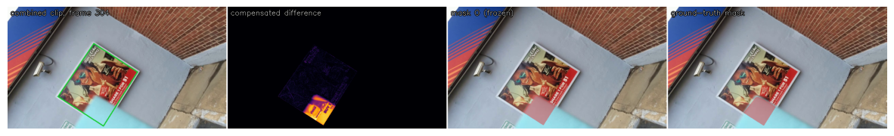

**Combined clip, test frame 304.** The bright residual follows the card across the lower part of the tilted poster. The predicted mask captures the main occluded region, with some disagreement along the annotated contour. Mask IoU was **0.880**, mask F1 was **0.936**, and boundary F1 was **0.772**. The panel uses the estimated homography.

### Question 4 — Occlusion
<!-- which occluders differencing recovers and which stay ambiguous; effect of the strong threshold and the minimum area; why hysteresis matters for thin occluders and why opening works against it (thinnest occluder that survives the frozen open_radius; what the radius buys over radius 0 on the validation masks); why the viewpoint clip produces false occlusion under strong perspective with a correct homography, and which part of the differencing is responsible -->
1. **Which occluders are recovered, and which remain ambiguous?**
The blue card is recovered where its colour contrasts with the poster. An occluder coloured like the board is ambiguous and can be missed. A shadow or specular highlight can be mistaken for foreground because it changes the board’s appearance. An occluder that stops moving remains detectable if it contrasts with the board, since each frame is compared with the clean reference.
2. **What happens when the strong threshold or minimum component area is raised?** On common validation frame 192 at 640-pixel width (Notebook 3, Section 5), raising the strong threshold from **0.25** to **0.375** or the minimum area from **38** to **228** pixels left the mask area at **15,997 pixels** and alpha leakage at **0.1%**. Enough strong seeds remained to recover the same region, and the card component exceeded both area cutoffs. Higher cutoffs can increase leakage if they remove genuine foreground.
3. **Why does hysteresis help thin occluders, and why does opening work against it?** Hysteresis retains weak pixels connected to a strong seed, which can preserve faint sections of a thin pole. Setting both thresholds to **0.25** on common validation frame 192 shrank the mask from **15,997** to **9,525 pixels** and raised alpha leakage from **0.1%** to **29.0%** (Section 5). Opening erodes the mask with a disc and then dilates what survives. If the disc cannot fit anywhere inside a thin component, erosion removes it entirely and dilation cannot restore it. With radius **2 pixels**, the thinnest horizontal strip to survive a separate synthetic check was **5 pixels** wide. In a separate comparison across the three common validation masks at 640-pixel width, changing only the radius from **0 to 2** removed a mean of **24 false-positive pixels per mask**. Mean IoU rose from **0.8976 to 0.8986**, while mean alpha leakage rose slightly from **1.35% to 1.37%**.
4. **Why does the viewpoint clip produce false occlusion even with a correct homography?** A correct homography aligns the board geometrically. Under strong foreshortening, fine texture can be sampled or blurred differently in the captured frame and the warped reference. The global gain and offset cannot account for these local changes, so the **compensated per-pixel colour difference** can exceed the foreground thresholds on an unobstructed board. In Notebook 3, Section 6, viewpoint test frame **288** has an **empty** ground-truth occlusion mask. Even with the evaluation-only ground-truth homography, the algorithm falsely masked **2.7%** of the visible board at 640-pixel width. The full-resolution flow-assisted video recorded **10.65%** false occlusion over the **two** empty-mask frames with detected overlays. This finished-video proxy is one minus visible-board coverage and also reflects feathering, resampling, and similarity between the artwork and source colours. The absent overlay on frame 288 was excluded.

## Stage 4 — Your clip
### Capture and audit
<!-- capture conditions (resolution, fps, duration, board fraction, pan / distance / angle / occlusion crossing), privacy, audit annotations recorded before any method ran -->
Shen Jingtao recorded my_clip handheld on an iPhone 12 at 1280 × 720, 30 fps, for 13.7 seconds. The target was a white-bordered landscape print mounted on a blue display board. Shen estimated the print’s physical dimensions at **0.36 × 0.25 m**. Its projected area occupied 25.6–42.2% of the image across the ten audited frames.

The camera pulled back around frames 0–120, panned laterally around 0–210, and moved to an oblique view around 195–410. An arm crossed the print around frames 349–373. These ranges are approximate and use zero-based frame indices. We obtained consent and removed identifying metadata before submission.

Before running either variant, Shen annotated the four board corners on 10 frames (21, 75, 120, 165, 210, 285, 351, 356, 360, and 390). Shen annotated five occlusion masks on those frames. Frames **21 and 285** were unobstructed, while **351, 356, and 360** showed the arm crossing the print. The annotation checker confirmed that the audit was complete.

### Overlay Scorecard
<!-- outputs/scorecards/<clip_id>_scorecard.md: both temporal variants, overlaylab.evaluate --clip <clip_id> -->
In `my_clip_scorecard.md`:

**Clip**: Rectangular landscape print with a white border mounted on a blue display board. iPhone 12, 1280x720, 30 fps, 13.7 s. Estimated board dimensions 0.36 × 0.25 m. Board coverage 0.256-0.422 of image area across 10 audited frames. Handheld lateral pan with a pull-back and a change from near-frontal to oblique viewing. Pull-back approx. 0-120; lateral pan approx. 0-210; oblique view approx. 195-410; arm overlap approx. 349-373.  
**Initialisation**: Frame 0, both variants: 94 reference and 208 frame keypoints, 32 matches, 14 inliers (43.8%), median residual 0.50 px.  
**Geometry**: Success threshold 1%. Independent: tracker median 0.69%, success 40% over 10 audit frames. Finished-video median 0.68%, success 40%. Flow-assisted: tracker median 0.69%, success 30% over 10 audit frames. Finished-video median 0.69%, success 30%.  
**Temporal**: Independent: tracker jitter 5.71 px, drift n/a (0 visible audit frames at least 16 frames after localisation), first successful audit frame after the crossing: 390. Flow-assisted: tracker jitter 5.11 px, drift n/a (0 visible audit frames at least 16 frames after localisation), first successful audit frame after the crossing: 390. The board stayed in frame, so recovery after re-entry is n/a.  
**Occlusion**: Independent: mask IoU n/a, F1 n/a (0/3 occluded masks scored, 3 hidden, 0 missing). Finished-video leakage 0.00%, baseline leakage n/a, visible-board coverage 97.22% over 2 mask frames. Overlay absent on [351, 356, 360]. Flow-assisted: mask IoU n/a, F1 n/a (0/3 occluded masks scored, 3 hidden, 0 missing). Finished-video leakage 0.00%, baseline leakage n/a, visible-board coverage 95.72% over 2 mask frames. Overlay absent on [351, 356, 360].  
**Monitor**: Independent: frames 349–373: HIDE/no_model: 20, OK/none: 5. First painted frame after the crossing: 380. Flow-assisted: frames 349–373: HIDE/no_model: 20, OK/none: 5. First painted frame after the crossing: 380.  
**Description**: Both variants hid the overlay on the three arm-occluded audit frames. The evaluator consequently measured zero leakage on those frames, while no foreground masks could be scored. The coverage figures describe the two clean mask frames.  
**Uncertainty**: The corner and mask labels came from one annotator, and the crossing limits are approximate. Jitter uses motion interpolated between ten corner annotations. The first successful audit frame establishes that recovery had occurred by that frame. The thresholds were transferred from the common clip, and no personal no-occlusion baseline was run.  

In summary, flow-assisted tracking reduced tracker jitter from **5.71 px to 5.11 px**, while placement success at the frozen 1% threshold fell from **4/10 to 3/10 audit frames**. Both variants had a median corner error of **0.69%** on finite estimates. Flow assistance therefore gave slightly smoother tracking where estimates were available, but passed the placement threshold on one fewer audit frame.

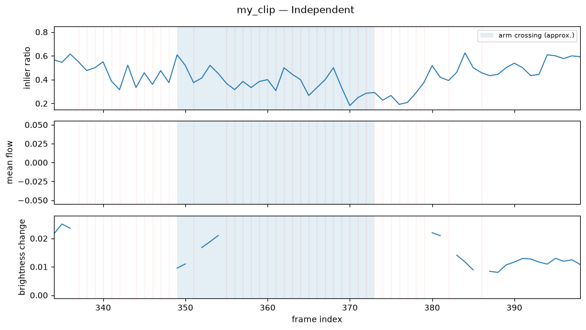
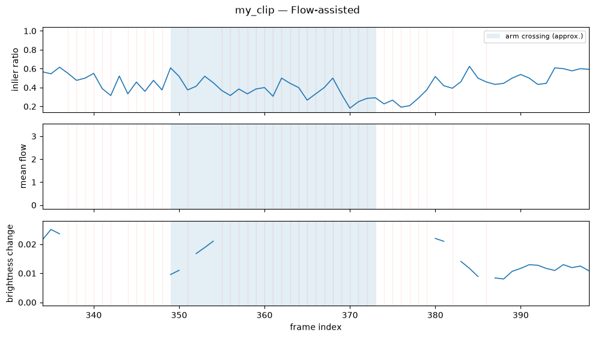

The two monitor timelines above show the same response during the estimated arm crossing (frames **349–373**). Both variants flagged **20 of 25 frames** as `HIDE/no_model` and hid the overlay on all three occluded audit frames. Hiding explains the **0% measured leakage**, and mask IoU and F1 were unavailable for those frames. Both variants resumed painting at **frame 380**, and **frame 390** was the first subsequent audit frame to meet the placement threshold.

**Representative overlay**
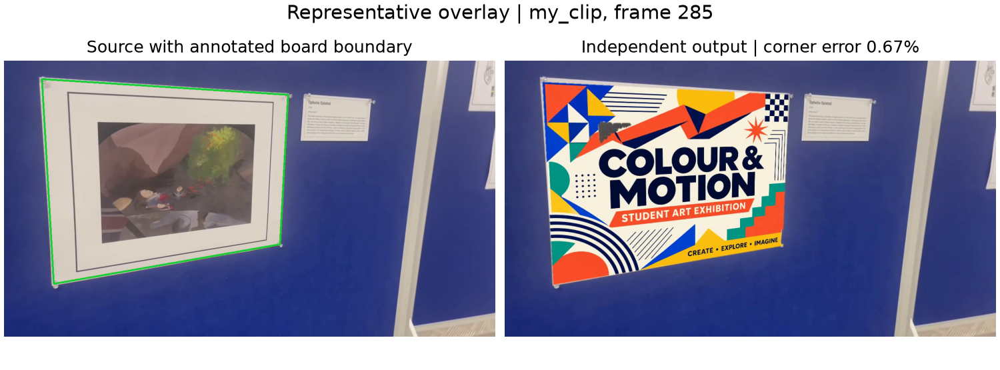
The source panel marks the annotated board boundary, and the independent output shows how the artwork follows the board’s oblique perspective. Both variants achieved a finished-video corner error of **0.67%** on this unobstructed audit frame, below the frozen **1%** success threshold.

**Failure frame**
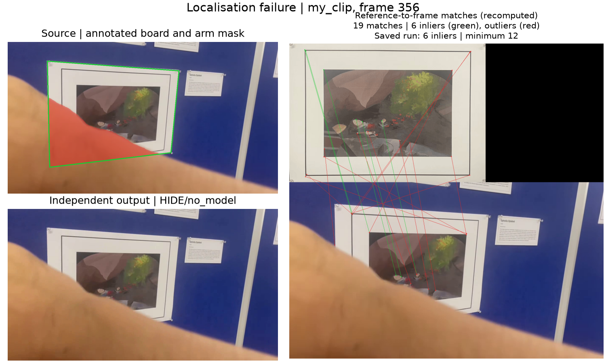
The arm covers part of the print. The match panel shows **19 candidate matches**, of which only **6** were RANSAC inliers (green), below the frozen minimum of **12**. Both variants recorded `HIDE/no_model`, so the rendered frame leaves the original print and arm visible. This frame illustrates why measured leakage can be zero when the overlay is hidden.

### Generative comparison
<!-- the open-weight video model you chose (direct pixel generation; inference scripts permitted), its settings, the video you gave it (whole clip, a cut, or joined segments), and why (cite the model); the seed, the log, the overlaylab.evaluate --frames report, comparison table against the classical output on the same frames, [AI-GENERATION] markers -->
We used the open-weight **Wan2.1-VACE-1.3B** model because it has lower memory and computational costs. The input was a cut of `my_clip` spanning source frames **208–359**, resampled to **81 frames at 16 fps**, together with `my_artwork.png`. We supplied no explicit mask and used the prompt “Replace the advertisement on the board in this video with the attached artwork.” The run used seed **42**, **50 UniPC steps**, shift **16**, guidance **5.0**, and bfloat16 on one **NVIDIA H100 NVL**. After a decoder dependency failure, we retried with the same inputs and settings. The successful run produced an **832 × 480** video at **16 fps** in **288.651 s**. [Wan model card](https://huggingface.co/Wan-AI/Wan2.1-VACE-1.3B) · [VACE paper](https://arxiv.org/abs/2503.07598)

We compared the generated video and both classical variants on the same source frames. These were **210** (clean), **285** (strongest perspective), **356** (occluded), and **315–316** (temporal pair). Placement and fidelity use the three corner-annotated frames. The generated frames were extracted at the corresponding source times and resized for evaluation. 

| Measure | Independent | Flow-assisted | Wan VACE [AI-GENERATION] |
|---|---:|---:|---:|
| Placement success at 1% | 2/3 (67%) | 2/3 (67%) | 0/3 (0%) |
| Median corner error on detected frames | 0.69% | 0.69% | n/a |
| Rectified artwork NCC / SSIM / structure | 0.569 / 0.476 / 0.293 | 0.569 / 0.476 / 0.293 | 0.122 / 0.265 / 0.020 |
| Flicker / warping error on frames 315–316 | 0.0997 / 0.0961 | 0.0997 / 0.0961 | 0.0302 / 0.0165 |
| Background PSNR / SSIM | 34.49 dB / 0.989 | 34.49 dB / 0.989 | 14.50 dB / 0.875 |
| Background drift | 4.73 px | 4.73 px | 299.35 px |
| Foreground leakage proxy on frame 356 | 0.0% | 0.0% | 99.9% |
| Visible-board coverage | 97.3% on 1 of 2 mask frames | 97.3% on 1 of 2 mask frames | n/a, 0 of 2 mask frames scored |
| Processing time / compute | 198.742 s / CPU | 249.394 s / CPU | 288.651 s / H100 NVL |
| Recovered corner jitter on frames 315–316 | 8.78 px | 8.78 px | n/a |
| Overlay absent on mask frames | 1/2, deliberately hidden | 1/2, deliberately hidden | 2/2, artwork undetected |
| Missing mask frames | 0 | 0 | 0 |

The classical times cover tracking and compositing on the full 411-frame clip. Wan’s time covers the successful generation on the shorter cut.

| Audit frame | Independent output | Wan output [AI-GENERATION] |
|---|---|---|
| **285 — strongest perspective** | 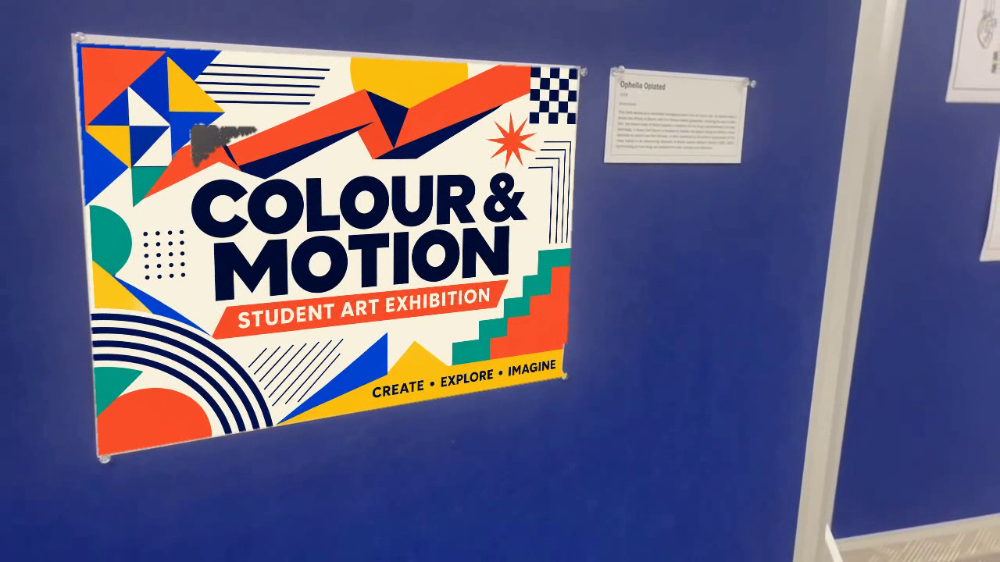 | 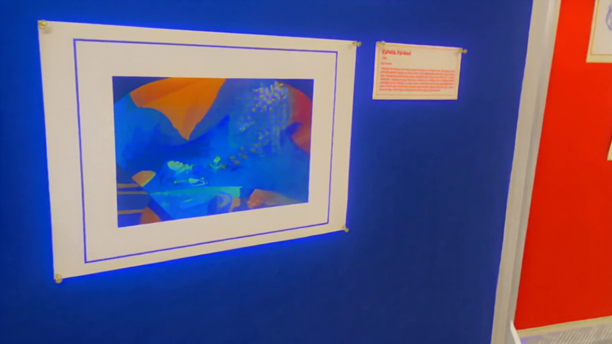 |
| **356 — arm crossing** | 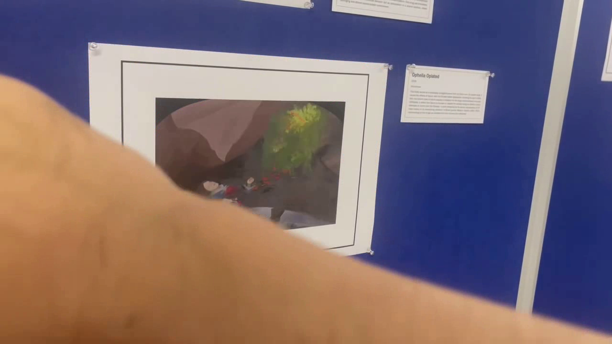 | 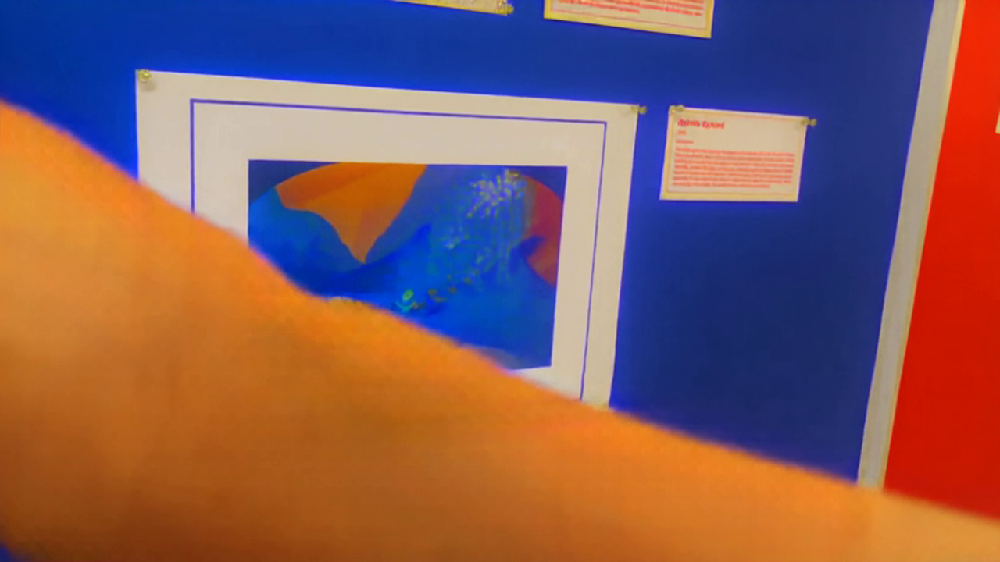 |

### Question 5 — Reflection
<!-- classical vs your generative model on your clip: geometric placement, artwork identity, occlusion order, background preservation (what the background PSNR says about generated vs composited pixels); controllability, cost; what the model generated outside the board and in front of it; whether it kept the clip's timing (compare with the staff MiniMax-H3 example in data/genai_oracle/) -->
**Geometric placement and artwork identity.** Independent registration and flow-assisted tracking both aligned the artwork with the board, with corner errors of **0.71% on clean frame 210** and **0.67% on the strongest-perspective frame, 285**. Both passed the frozen 1% threshold on **2 of 3** placement frames. Wan preserved the shape of the framed print but recoloured the original picture blue and orange. The supplied **“COLOUR & MOTION”** text and layout are missing. Wan’s artwork NCC and structure scores were **0.122** and **0.020**, compared with **0.569** and **0.293** for each classical variant. The evaluator recovered no artwork homography on Wan’s three placement frames, giving **0/3 success** and no median corner error.

**Occlusion order and background preservation.** Neither approach delivered the intended artwork behind the arm on frame 356. Both independent and flow-assisted variants hid the overlay after losing localisation, while Wan kept the arm in front but recoloured it. The original print and arm of independent and flow-assisted variants remained visible, giving both variants **0% leakage**. Their **97.3% visible-board coverage** comes from unobstructed frame **285** alone. Wan's **99.9% leakage** means almost all pixels in the annotated arm region changed beyond the evaluator’s threshold. Wan’s coverage is unavailable because the evaluator detected no artwork on either mask frame. Wan also recoloured the surrounding display, turning the adjacent panel bright red in frame 285. Its background PSNR and SSIM were **14.50 dB** and **0.875**. Both classical variants scored **34.49 dB** and **0.989**, consistent with the compositor copying pixels outside its predicted overlay region before encoding.

**Timing.** The arm appears across the board in Wan’s output at the nominal time for frame **356**. Wan's lower flicker and warping error on **315–316** show less change on that one pair, while the artwork is still incorrect and recovered corner jitter is unavailable. The large background drift shows that some matched-time frames disagree strongly with the source. Since Wan also changed the background’s appearance, that metric alone cannot isolate how much of the disagreement came from retiming.

**Controllability and cost.** In the classical pipeline, swapping the artwork changes the intended pixels directly, while the homography, mask, and failure monitor govern placement and visibility. Wan’s prompt and reference image specify the desired edit, but the model decides how to render it. The run for Wan required preparing the cut, transferring inputs, configuring the model, and spending **288.651 s on an H100**. The classical runs took **198.742 s** and **249.394 s** on CPU for the full clip. The different durations and hardware limit a direct speed comparison.

**Staff comparison.** The staff MiniMax-H3 run on the common clip recovered the artwork on **100%** of its evaluated placement frames, with **0.32 NCC**, compared with **0% detection** and **0.122 NCC** for Wan on our clip. The staff run still had **20.04 dB** background PSNR, **264.89 px** background drift, and **8.3%** foreground leakage. Both runs show that reproducing an artwork and preserving the rest of the video are separate challenges. The clips and settings differ, so this comparison cannot isolate the effect of model size. These results describe one generation per setup. 

## Evidence table
| Student file    | Function                     | Report section             | Notebook figure / table / video                                                 |
| --------------- | ---------------------------- | -------------------------- | ------------------------------------------------------------------------------- |
| keypoints.py    | harris_response              | Stage 1 (Keypoints)        | Notebook 1 §3 Harris response map + count sweep                                        |
| keypoints.py    | detect_corners               | Stage 1 (Keypoints), Q1    | Notebook 1 §3 NMS mode/repeatability sweep (radius, σ_w=2.0, κ=0.05, rep. 0.852)       |
| keypoints.py    | describe_keypoints           | Stage 1 (Keypoints), Q1    | Notebook 1 §4 match-quality counts; §5 rotation 96% vs scale 10% retention             |
| keypoints.py    | match_descriptors            | Stage 1 (Keypoints), Q1    | Notebook 1 §4 ratio-test histogram (200/349 accepted); §5 collapse pair scale 80→96    |
| geometry.py     | bilinear_sample              | Stage 1 (Geometry)         | Notebook 1 §8 warp checkerboard; exercised inside warp_artwork / lk_flow               |
| geometry.py     | normalise_points             | Stage 1 (Geometry)         | Notebook 1 §6 conditioning (σ₁/σ₈ = 3.36 vs 2.01e+05), exercised inside dlt_homography |
| geometry.py     | dlt_homography               | Stage 1 (Geometry), Q2     | Notebook 1 §6 degeneracy (collinear status False); NB2 §4 least-squares column         |
| geometry.py     | symmetric_transfer_error     | Stage 1 (Geometry)         | Notebook 1 §7 RANSAC residual histogram (residual metric)                              |
| geometry.py     | ransac_homography            | Stage 1 (Geometry), Q2     | Notebook 1 §7 threshold/iteration sweep & N(p,ε); NB2 §4 RANSAC vs least-squares table |
| geometry.py     | transfer_points              | Stage 1 (Geometry)         | Notebook 1 §3/§6 corner transfer; NB2 §5 affine-vs-homography corners                  |
| geometry.py     | warp_artwork                 | Stage 1 (Geometry)         | Notebook 1 §8 coverage bbox check; cv2.warpPerspective agreement 0.0015                |
| localisation.py | localise_board               | Stage 1 (Localisation), Q2 | Notebook 2 §2–§3 validation/test; §5 viewpoint homography vs affine                    |
| localisation.py | artwork_to_frame             | Stage 1 (Localisation)     | Notebook 2 §6 single-frame overlay (composed homography)                               |
| localisation.py | overlay_frame                | Stage 1 (Localisation)     | Notebook 2 §6 single-frame overlay figure                                              |
| localisation.py | evaluate_audit_frames        | Stage 1 (Localisation)     | Notebook 2 §2 validation per-frame; §3 test summary {median 0.47%, success 1.0}        |
| temporal.py     | lk_flow                      | Stage 2, Q3                | Notebook 2 §7 eigenvalue scatter (5/82 valid); cv2 agreement 0.023 px                  |
| temporal.py     | track_board                  | Stage 2, Q3                | Notebook 2 §8 independent vs flow-assisted (flicker vs drift); Stage 2 stress table    |
| temporal.py     | failure_monitor              | Stage 2, Q3                | Notebook 2 §9 first flag (45, REINIT, brightness_change); §10 combined/exit timelines  |
| compositing.py  | hysteresis                   | Stage 3, Q4       | Notebook 3 §5, setting the weak threshold equal to the strong threshold  |
| compositing.py  | compensated_difference       | Stage 3, Q4       | Notebook 3 §2, warped reference, fitted gain and offset, and compensated difference map |
| compositing.py  | occlusion_mask               | Stage 3, Q4       | Notebook 3 §4, predicted mask and component statistics for common test frame 144 |
| compositing.py  | select_difference_thresholds | Stage 3, Q4       | Notebook 3 §3, ranked results on the three common validation masks and frozen settings written to `thresholds.json` |
| compositing.py  | composite                    | Stage 3, Q4       | Notebook 3 §4, alpha leakage and side-by-side composites with and without occlusion handling on common test frame 144 |

## AI-use disclosure table

Marker legend: `[AI-CODE]` AI wrote/edited code · `[AI-DESIGN]` AI influenced a design/algorithm choice · `[AI-VISION]` AI interpreted image/visual content · `[AI-GENERATION]` AI generated pixels (Stage 4 generative video) · `[AI-LANGUAGE]` AI wrote/edited prose · `[HUMAN-DATA]` data captured/annotated by a human · `[HUMAN-CHECK]` a human verified the output.

| Tool / model             | Affected artefacts (file, cell, figure, section)                | Markers                     | What the tool contributed                                                                          | How it was verified                                                                                                                                                                                                                          |
| ------------------------ | --------------------------------------------------------------- | --------------------------- | -------------------------------------------------------------------------------------------------- | -------------------------------------------------------------------------------------------------------------------------------------------------------------------------------------------------------------------------------------------- |
| Kiro CLI (LLM assistant) | `REPORT.md` — Stage 1 and Stage 2 prose, Question 1, Question 2 | [AI-LANGUAGE] [HUMAN-CHECK] | Improved the Stage 1/2 narrative and question answers draft from numbers produced by notebook runs | Each quoted number was cross-checked against `outputs/stress_tables.md` and the `.ipynb` stream outputs; the report's Stage 1/2 table rows were diffed against `stress_tables.md` and match verbatim. Authors to read and confirm the prose. |
| OpenAI Codex | Notebook 3 experiment design | [AI-CODE] [AI-DESIGN] | Helped design the threshold and opening-radius comparisons. |  Notebook 3 recorded the validation settings, test results and hysteresis comparison. |
| OpenAI Codex | Notebook 4 Part I Scorecard, monitor timelines and frame evidence. Part II §5 comparison table. | [AI-CODE][AI-DESIGN] | Helped write the scorecard, diagnostic plots and comparison-table code. | The scorecard and comparison table were checked against the saved tracker statistics and evaluator reports. |
| OpenAI Codex | `REPORT_TEMPLATE.md`, Stage 3 and Stage 4 prose, Q4 and Q5 | [AI-LANGUAGE][HUMAN-CHECK] |Helped draft and revise the implementation discussion and answers using the notebook results. | The numerical claims were checked against notebook outputs, stress tables and evaluation reports. The frame descriptions were checked against the displayed panels and saved diagnostics. |
| Wan-AI/Wan2.1-VACE-1.3B | `outputs/genai/output.mp4`, extracted Wan frames and Stage 4 comparison figures | [AI-GENERATION] | Generated the edited video from source frames 208–359 and the supplied artwork reference using seed 42. | FFprobe confirmed 81 frames at 832 × 480 and 16 fps. Notebook 4 compared the generated and classical outputs at matched source times. Wan passed 0 of 3 placement checks. |
